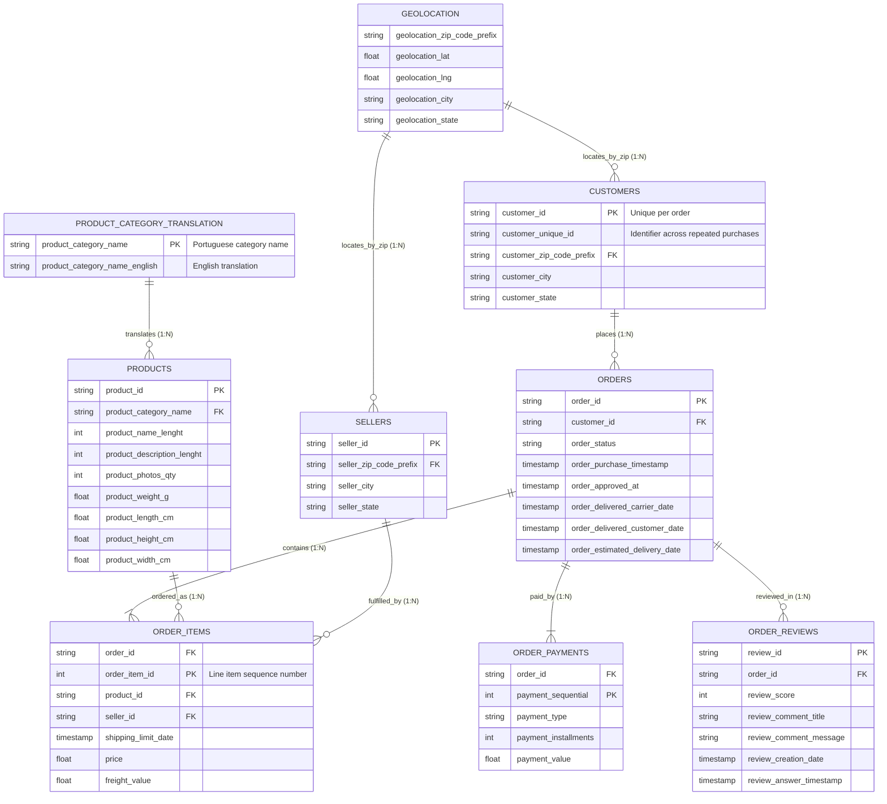

# Entity-Relationship Diagram (ERD) & Schema Architecture

## 1. Relational Architecture Diagram

The Olist e-commerce database contains nine relational tables centered on `orders`, which connects customers, line items, payments, sellers, and reviews.

---

## 2. Table-by-Table Architectural Description

| Table Name | Primary Role | Key Identifiers (PK / FK) | Business Importance |
| :--- | :--- | :--- | :--- |
| **`orders`** | Core Fact Table | **PK:** `order_id` **FK:** `customer_id` | Tracks lifecycle timestamps (purchase, approval, dispatch, delivery, estimated delivery). |
| **`customers`** | Customer Dimension | **PK:** `customer_id` **Ref:** `customer_unique_id` | Differentiates distinct purchase transactions from repeat unique buyers. |
| **`order_items`** | Line Items Fact Table | **Composite PK:** `(order_id, order_item_id)` **FKs:** `product_id`, `seller_id` | Individual products inside an order, prices, and shipping logistics costs. |
| **`order_payments`** | Payments Fact Table | **Composite PK:** `(order_id, payment_sequential)` **FK:** `order_id` | Payment methods (credit card, boleto, voucher), installments, and paid amounts. |
| **`order_reviews`** | Customer Sentiment | **PK:** `review_id` **FK:** `order_id` | 1-5 star ratings and customer text feedback. Critical for satisfaction analysis. |
| **`products`** | Product Dimension | **PK:** `product_id` **FK:** `product_category_name` | Physical attributes, dimensions, and category classifications. |
| **`sellers`** | Seller Dimension | **PK:** `seller_id` | Seller locations (city, state, zip) for fulfillment route optimization. |
| **`product_category_name_translation`** | Localization Lookup | **PK:** `product_category_name` | Translates Portuguese product taxonomy into standardized English names. |
| **`geolocation`** | Spatial Dimension | **Key:** `geolocation_zip_code_prefix` | Latitudes and longitudes for geographical density and delivery mapping. |

---

## 3. Critical Data Engineering Relationships & Notes

1. `customer_id` vs `customer_unique_id`:
   - In Olist, `customer_id` is assigned per order (ephemeral transaction key).
   - `customer_unique_id` identifies the actual human behind repeat transactions. This distinction is mandatory for repeat customer analysis and customer lifetime value (CLV).

2. Composite keys in line items and payments:
   - Multiple items in a single order share the same `order_id`; they are uniquely indexed by `order_item_id`.
   - Customers can pay using multiple vouchers or mixed payment methods; indexed by `payment_sequential`.

3. Date & timestamp formats:
   - All 5 timestamps in the `orders` table (`purchase`, `approved_at`, `carrier_date`, `delivered_date`, `estimated_delivery_date`) must be cast to `datetime64[ns]` in Pandas / `DATETIME` in SQL for valid delivery duration and delay calculations.
